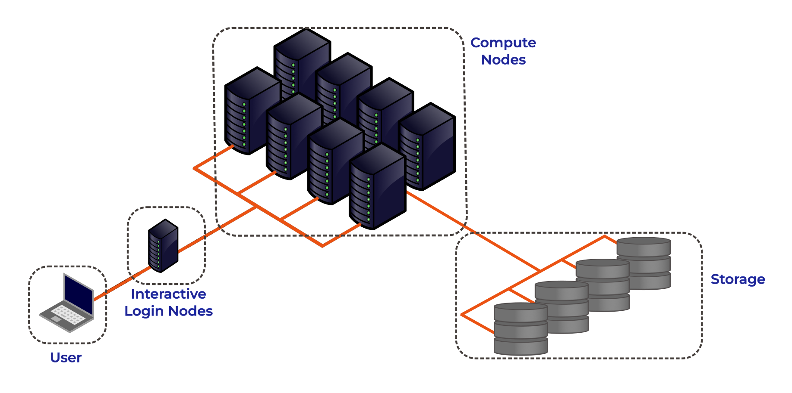
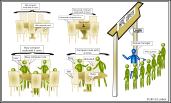

class: title

# Byte-sized RSE: Introduction to HPC with Python
## Corran Webster
### Southampton Research Software Group

---
class: title

# Overview

**Introduction:** Introduction to HPC with Python

**Practical activity:** Python Concurrency

## You should have done setup!

---
class: title reverse

# HPC with Python
# Introduction

---

# High Performance Computing Basics


.left-column[

- An HPC cluster is a group of shared computers.
- Each individual computer or 'node' is more powerful than a typical workstation.
- A cluster will have shared high-performance storage.
- Typically only the login node can see the wider internet.
]
.right-column[
  
]

---

# The HPC World

.left-column[

- In the UK HPC facilities are ranked in Tiers from local to continental
- Iridis is Southampton's local HPC facility
- It consists of 3 clusters: Iridis 6, Iridis X and Iridis 7
]
.right-column[
  
]

???

-

---

# Accessing Iridis

.left-column[

From the Bash command-line:
``` bash
$ ssh username@iridis6.soton.ac.uk

	###########################

        WELCOME TO IRIDIS 6

	###########################

Last login: Mon Nov 16 15:01:31 2026
[username@login6001 ~]$
```
Or use an SSH client like PuTTY.
]
.right-column[

- Access to Iridis is through secure shell (SSH) to a login node from inside the University of Southampton's network or by VPN.
- The login node is a powerful Linux computer shared by many users where you can perform short, small tasks.
]

---

# Job Scheduling


.left-column[

- Iridis uses the SLURM scheduler which allocates time for each user.
- Work is configured with a **submission script** and run with the `sbatch` command
- Interactive sessions are scheduled with the `sinteractive` command.
]
.right-column[

  
]
???

-

---

# Submission Scripts

.left-column[

```bash
#!/bin/bash

#SBATCH --partition=batch
#SBATCH --time=00:01:00
#SBATCH --nodes=1
#SBATCH --cpus-per-task=2

# This is the command that will run
pwd
```
]
.right-column[

- The script is a collection of Bash commands to run one after another
- The special `#SBATCH` comments configure the parameters of the job.
]

???

- `partition` selects which group of computers to use
- `nodes` selects how many computers to use; each node runs one or more tasks
- `ntasks` or `ntasks_per_node` select how many different tasks or concurrent programs to run
- `cpus-per-task` selects how many CPUs to allocate to each task
- `time` sets the maximum time to allow for the job

---

# Monitoring Jobs

- The `squeue -u $USER` command shows you the state of your jobs.
- You can get more detailed information about a job using `scontrol show jobid=` and the ID of your job
- You can cancel a job using the `scancel` command with the ID of the job.
- Output will appear in a text file starting with `slurm-` followed by the job number.
- When complete, this file will contain error messages and performance feedback.

---

# Limits and Quotas

- Iridis is a shared system, so there are limits on what individual users can do.
- There are limits to the number of nodes, CPU and amount of memory that can be used.
- There are limits to the size of data stored, and the number of files.
- There are two places to store data: the `/home/$USER` directory (which is backed-up) and the `/scratch/$USER` directory (which is not).
- Usage can be checked with the `myquota` command.

---

# Modules

- Different HPC programs use different versions of underlying technologies
- You need to select which technologies you are using, such as languages, GPU support, compilers, etc. through the **module** system on Iridis
- For example, if your code needs Python 3.14 you load it using the Bash command `module load python/3.14`
- You can see all available modules with the `module avail` command.

---

# Parallel Programming

.left-column[

- Some algorithms have multiple steps that don't depend on each other.

``` python
def double(i):
    return 2 * i

result = []
for i in range(n_tasks):
    result.append(double(i))
```
]
.right-column[

- These computations can be performed more quickly by distributing the work over multiple CPUs or computers.
- Running in parallel adds complexity and has overhead.
- Code should be as fast and efficient as possible before trying running in parallel.
]

---

# An Analogy: Painting a Room

- A room needs to be painted as quickly as possible.
- Painters can work in parallel to paint the room more quickly.
- Difficulties which may occur:
  - Communication, eg. who paints what?
  - Usage of shared resources, eg. if there is only one tin of paint.
  - Too many painters.
  - Things which can't be sped up, eg. it takes time for paint to dry.
- These are all analogous to problems that parallel code can have.


---

# Threads, Processes, and Tasks

- a **task** is a unit of work in SLURM
- each node might run multiple tasks
- each task might start multiple **processes**
- each process might run multiple **threads**
- threads within a process share memory, so communication is fast
- the total number of threads which can run at any time is equal to the number of CPU cores available
- one task with multiple processes and/or threads often suffices

---

# Parallel Tasks

- To run tasks in parallel, prefix with `srun` like so: `srun python my_script.py`
- Environment variables give information for each task:
  - `SLURM_PROCID` is the index or **rank**
  - `SLURM_NTASKS` is the total number of tasks
  - there are many other potentially useful variables
- in Python use `os.environ.get` to get the value of an environment variable

---

# Example code

[`my_script.py`](files/my_script.py)
``` python
import os

print("Running on", os.environ.get("HOSTNAME"))
print("NTASKS", os.environ.get("SLURM_NTASKS"))
print("PROCID", os.environ.get("SLURM_PROCID"))
print("NODEID", os.environ.get("SLURM_NODEID"))
print("LOCALID", os.environ.get("SLURM_LOCALID"))
```

---

# Example batch file

```bash
#!/bin/bash

#SBATCH --job-name=python-example
#SBATCH --partition=batch
#SBATCH --time=00:10:00
#SBATCH --nodes=2
#SBATCH --tasks-per-node=2
#SBATCH --cpus-per-task=1

# Load required modules
module load python

# Run the Python script on multiple nodes
srun python my_script.py
```

---

# Dividing Work

.left-column[

- When using `srun` each task needs to work out what it will do.
- In simple cases the rank can be used for this.
- But often tasks will need to communicate to coordinate work or report results.
]
.right-column[

``` python
import os

all_files = os.listdir('flowers-102')

i = int(os.environ["SLURM_NODEID"])
n = int(os.environ["SLURM_NTASKS"])

# slice every nth file, starting at i
# first gets 0, n, 2n, ...
# second gets 1, n+1, 2n+1, ...
# etc.
task_files = all_files[i::n]

for file in task_files:
    augment_image(file)
```
]

---

# MPI (Message Passing Interface)

- MPI provides a way for nodes to communicate with each other.
- To run code using MPI:
  - load OpenMPI: `module load openmpi`
  - use `mpirun` instead of `srun`.
- Basic MPI is fairly low-level and intrusive to your code.
- Python's MPI4Py has a higher-level approach that uses `concurrent.futures` to allow almost identical code to be run both locally and with MPI.

---

### Why Python is Bad for HPC

- Python is 5-10 times slower than C and consumes more memory.
- Effective parallel code in Python is hard or resource-intensive.
- Python environments use many small files.

### Why Python is Good for HPC

- Python was designed for "part-time programmers".
- Python has an extensive and fast scientific library ecosystem.
- Python is an excellent "glue" language to combine code from C, C++, Fortran, etc.

---

# Effective Use of HPC

- Research code requires a lot of experimentation. The faster your experiments fail, the quicker you can work out what is wrong.
- HPC batch systems have long turn-around times so get code working *locally* first on a small subset for fast turn-around.
- Make code as efficient as practical:
  - Use NumPy, SciPy, Pandas, Pillow, OpenCV, etc. for speed.
  - For algorithmic bottlenecks consider using Numba or Cython.
- Run the *same* code under HPC and scale up as needed.

---

class: title reverse

# Data Augmentation
# Practical Activity

---

# Activity Introduction

- We have code that prepares images for machine learning which we will modify to run on Iridis 6.
- We'll demonstrate this via live coding.
  - We'll use a repository with example code.

---
class: title reverse

# Thank you!
# What questions do you have?
